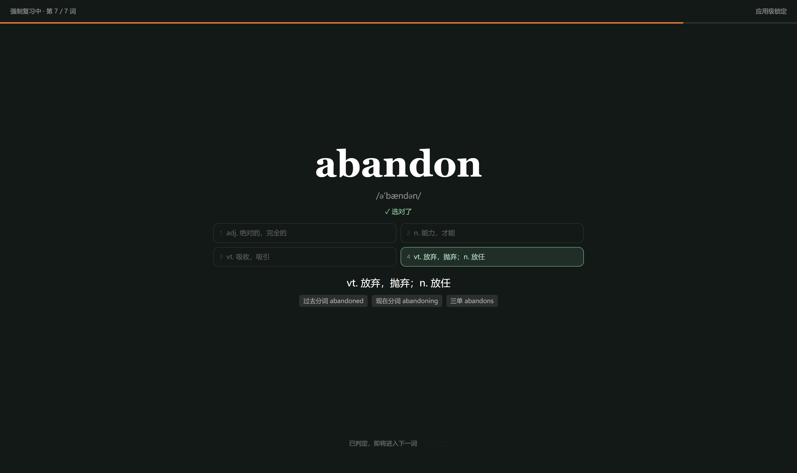
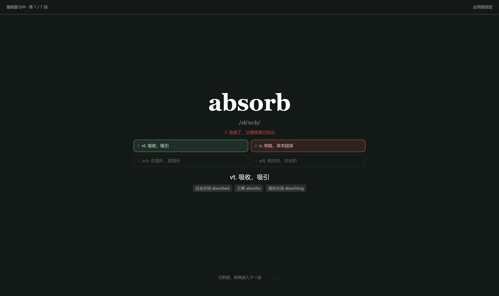

<div align="center">

# 赶词工

**别让单词等你。**

一款「主动找上门」的 Windows 单词复习工具：到点自动弹窗，延后次数有限，复习完自动消失。
桌面悬浮球实时倒数下一轮复习，词库、排程、记录全部留在本地，断网也能用。

[](https://tauri.app/)
[](https://www.rust-lang.org/)
[](https://vuejs.org/)
[](https://www.typescriptlang.org/)
[](#已知边界)
[](LICENSE.txt)

</div>

---

## 这是什么

大多数背单词软件假设你会主动打开它。赶词工反过来：**你把复习时段设好，剩下的交给调度器**。

到点后，它会以温和弹窗或强制全屏的方式把一轮单词推到你面前。你可以「稍后」，但每天只有固定的几次额度；额度用完，就只剩「开始复习」。复习完最后一个词，窗口自动关闭，桌面恢复原样。

不想被弹窗打扰时，桌面边缘的悬浮球会用一圈进度环告诉你「距离下一轮还有多久」，点开即可查看待复习数量或直接开始。

- 不是打卡工具，不排名、不社交、没有账号
- 不是云端服务，所有数据都在本机 SQLite 里
- 不靠意志力，靠「到点躲不掉」

## 截图

<p align="center">
  
  <br>
  <sub>强制全屏复习：看英文选释义，作答后短暂停留展示判定，再自动进入下一词</sub>
</p>

<table>
  <tr>
    <td width="50%"></td>
    <td width="50%"></td>
  </tr>
  <tr>
    <td align="center"><sub>答对：正确项高亮，右下角显示当日剩余延后次数</sub></td>
    <td align="center"><sub>答错：正确答案标绿、误选项标红，并展示词形变化</sub></td>
  </tr>
</table>

## 功能总览

| 模块 | 能力 |
| --- | --- |
| 主动触发 | 多个复习时段、弹窗间隔、单次词数、每日新词目标；Rust 调度器到点直接开窗，无需点击 |
| 桌面悬浮球 | 72px 常驻圆环，倒数下一轮复习；点开快捷菜单查看进度、待复习数与错词数，也能直接复习/背单词 |
| 复习形态 | 温和弹窗 / 强制全屏；强制全屏再分「应用级」与「Kiosk 级」两档锁定强度 |
| 出题方式 | 看词选义、看中文默写、缺释义时翻牌；可在设置里固定或交给自动规则 |
| 背单词 | 独立沉浸式学习流：打字记词 → 选择释义 → 自评认识程度，一批学完统一写入排程，学习中暂停提醒 |
| 间隔排程 | 艾宾浩斯分钟级阶梯：5 分 → 30 分 → 12 小时 → 1/2/4/7/15/30/60 天，7 天视为已掌握 |
| 延后配额 | 默认每天 3 次、每次 10 分钟；跨天自动重置，用完只剩「开始复习」 |
| 本地词库 | 多词表、单元分组、增删改查、搜索、例句与标签、到期时间与遗忘次数 |
| 错词本 | 汇总每日答错与遗忘的词，可单独发起一轮「错词复习」 |
| CSV | 导入兼容 UTF-8 / UTF-8 BOM / GBK，导出统一 UTF-8 BOM，双击 Excel 不乱码 |
| 离线词典 | 内置 18,162 个考试词条，导入时自动补音标、释义与词形变化，零联网 |
| 练习模式 | 自由默写，不写排程、不计入复习进度 |
| 练习巩固 | 5 种练法：翻卡、看词选义、看中文选词、全拼默写、听词辨义；按今日已学 / 错词本 / 复习中取词，每组 20 个，不影响排程 |
| 统计 | 近 14 天认识率、最容易忘记的词、词库构成、最近轮次 |
| 外观 | 亮色 / 暗色 / 跟随系统，六种主题色，可上传自定义背景并调节遮罩强度 |
| 桌面行为 | 托盘常驻、开机自启（打包态）、单实例、关闭主窗口只隐藏、悬浮球可隐藏 |
| 音效 | 打字音效与系统 TTS 发音，可分别关闭 |
| 逃生机制 | 全局 `Ctrl + Alt + Esc`，任何锁定状态下都能中断本轮并恢复桌面 |

## 核心循环

```
设置时段 → 调度器算出下一轮 → 到点开窗 → 逐词作答 → 应用复习阶梯 → 写日志 → 关窗
                                      ↘ 点「稍后」→ 扣当日额度 → 推迟 N 分钟
```

下一轮时间由「已到期单词 + 弹窗间隔网格」共同决定：没有到期词时顺延到下一个网格点，有到期词则提前到最近到期时刻，并且始终落在你设置的复习时段内。每轮结束后计时从结束时刻重新起算，至少等满一个完整间隔再提醒，作答耗时不会把下一轮挤到刚关窗之后。悬浮球和快捷菜单展示的倒计时就来自同一份调度状态。

抽词规则（一轮 N 个，默认 10）：

1. 已学过且 `due_at <= now` 的词，按到期时间升序优先
2. 不足时补新词，按录入顺序，并受每日新词目标约束
3. 仍不足时补最接近到期的词，允许提前复习
4. 一个词都没有时不弹空窗：定时触发会留一条 `status='empty'` 的轮次记录；手动点「开始复习」只提示没有可复习的词。

## 悬浮球与下一轮提示

- 默认停靠在主屏右侧，可拖动，松手后自动吸附回工作区（保留 10px 边距），不会跑出屏幕或压住任务栏
- 圆环进度 = 剩余时间 / 本轮间隔，从调度器设定下一轮的时刻开始倒计时；没有排程时隐藏圆环并显示原因
- 点击悬浮球弹出快捷菜单：今日待复习、错词本数量、下一轮倒计时与进度条，以及复习 / 背单词 / 词库 / 错词本 / 统计 / 设置入口
- 开始复习时自动收起悬浮球，防止挡住弹窗或成为绕过锁定的入口；退出复习后恢复
- 右键或菜单里的「隐藏悬浮球」可关闭，设置页可重新开启

## 复习排程

每个单词维护 `interval_minutes` 与 `due_at`：

| 标记 | 间隔变化 | 说明 |
| --- | --- | --- |
| 认识 | 5 分 → 30 分 → 12 小时 → 1 → 2 → 4 → 7 → 15 → 30 → 60 天 | 每次爬到阶梯下一级，60 天封顶 |
| 不认识 | 直接回到 5 分钟 | `lapses += 1`，当天进入错词本 |

间隔达到 7 天即视为「已掌握」，不再占用每日新词节奏；数据库仍以分钟存储，向上兼容早期的按天间隔。

## 三种出题方式

| 模式 | 形式 | 何时使用 |
| --- | --- | --- |
| `choice` | 看英文，从 4 个释义里选 1 个 | 复习过的词，默认自动选用 |
| `spell` | 看中文，逐字母默写英文 | 新词，默认自动选用；也适合强记忆 |
| `reveal` | 卡片翻面，自评认识 / 不认识 | 没有释义、无法出选择题时的兜底 |

设置里的「出题方式」可选 `auto`（新词默写、复习过的选义）、`spell`、`choice` 三种，即时生效。独立的「背单词」页会依次经过打字记词、选择释义、认识程度三个阶段，最后按掌握程度一次性更新排程。

## 两种复习形态与锁定强度

| 形态 | 表现 | 关闭 / 延后 |
| --- | --- | --- |
| 温和弹窗 `gentle` | 420×300 无边框窗口，置顶但不抢焦点，可拖动，默认右上角 | 点关闭或「稍后」消耗 1 次延后额度 |
| 强制全屏 `fullscreen` + `app` | 无边框全屏、最高置顶、失焦夺回、禁止关闭；可配置覆盖所有显示器 | 仅「本轮稍后」（额度未耗尽时）可用；Alt+Tab 离开会被记为中断 |
| 强制全屏 `fullscreen` + `kiosk` | 在应用级之上启动 PowerShell 低级键盘钩子，屏蔽 Win / Alt+Tab / Alt+F4 / Ctrl+Esc | 逃生键由钩子自身识别并放行 |

### 逃生与安全设计

- 全局逃生键 `Ctrl + Alt + Esc`，在任意模式下中断本轮并写入 `escape_used` 事件；已作答的词保留排程更新，未作答的词不动。
- 如果逃生键注册失败（被别的程序占用），强制模式会**自动降级为温和弹窗**，绝不锁住一个没有出口的桌面。
- Kiosk 钩子是独立 PowerShell 子进程：主进程每 1 秒写一次心跳，超过 15 秒没有心跳，子进程自行卸载钩子退出。主进程崩溃也不会把桌面锁死。
- 子进程退出码即原因：`7` 逃生、`8` 心跳超时、`9` 达到 3 小时硬上限、其他为异常。
- `Ctrl + Alt + Del` 属于 Windows 安全序列，任何用户态程序都无法屏蔽——这是刻意保留的最后退路。
- 上次异常退出留下的未完成轮次，启动时静默补记为 `aborted`，不会重复弹窗轰炸。

## 离线词典

- 数据源：[ECDICT](https://github.com/skywind3000/ECDICT) 派生的 `cdict_query@1.0.0`（MIT），构建脚本筛选 `zk / gk / cet4 / cet6 / ky` 考试标签与高频词
- 产物：[`resources/dictionary/words.json`](resources/dictionary/words.json)，实测 **18,162 词条、3.01 MB**，其中 17,334 条带音标、15,203 条带词形变化
- 额外建立「变形 → 原形」倒排索引，`abandoned`、`studies` 这类词也能查到
- 导入或新增单词时若释义为空，自动查表补全；查不到则标记为「待补充释义」
- 打包时词典作为 Tauri 资源随安装包放到安装目录的 `resources/` 下，运行时只读本地文件，**无任何出站网络请求**

重新生成词典：

```bash
npm run dict:build
```

脚本会从 npmmirror 下载源包到 `.cache/`（需要 `curl` 和 `tar`），首次约 11 MB。仓库里已经提交了生成好的 `words.json`，一般不需要重建。

## CSV 约定

- 导入编码：UTF-8（含 / 不含 BOM）与 GBK，由 Rust 端 `encoding_rs` 识别转换
- 表头自动映射：`word|term|单词|apparent` → 单词；`meaning|释义|翻译|translation|chinese` → 释义；`phonetic|音标`；`example|例句`；`tag|标签|词表`
- 只有单词列也能导入，释义走离线词典
- 导出列：`term,phonetic,meaning,example,tags,interval_days,due_at,reps,lapses`，UTF-8 BOM
- 示例文件：[`samples/四级核心20词.csv`](samples/四级核心20词.csv)

## 键盘操作

| 场景 | 按键 |
| --- | --- |
| 看词选义 | `1`–`4` 选择；判定后 `Space` / `Enter` 立即下一题 |
| 看中文默写 | 字母键输入；`Backspace` 删除；判定后 `Space` / `Enter` 立即下一题 |
| 翻牌 | `Space` 翻面；`1` 不认识；`2` 认识（`Enter` 等同于认识） |
| 结算页 | `Enter` / `Esc` 立即关闭 |
| 练习 / 背单词 | 字母键输入；`Backspace` 删除；`Enter` 下一词 |
| 全局逃生 | `Ctrl + Alt + Esc` |

作答后会在判定结果上短暂停留再自动进入下一词，也可以直接按 `Space` / `Enter` 跳过等待。

## 技术栈

| 层 | 选型 |
| --- | --- |
| 桌面运行时 | Tauri 2.12（Rust 后端 + 系统 WebView2） |
| 界面 | Vue 3.5 + TypeScript 5.9 + Naive UI + Tailwind CSS v4 |
| 状态与路由 | Pinia 3、Vue Router 4（hash 模式） |
| 存储 | SQLite（`rusqlite` 静态编译，WAL 模式） |
| 后端能力 | 调度、轮次、复习窗口、悬浮球、Kiosk、CSV、词典、托盘、开机自启 |
| 前后端通信 | Tauri command + 事件，渲染层通过 `window.ganci` 类型化封装调用 |
| Tauri 插件 | single-instance、autostart、global-shortcut、dialog、opener |
| CSV | PapaParse（前端）+ `csv` / `encoding_rs`（Rust） |
| 词典 | 离线 JSON，源自 ECDICT |
| 打包 | Tauri NSIS x64；网络受限时可用 `npm run build:installer` 出包 |

选择 `rusqlite`（bundled）而不是引入外部 SQLite DLL：数据库引擎直接编进 exe，安装后不依赖任何额外运行库；同步 API 对千级词条完全够用，WAL 也保证了弹窗调度与界面查询互不阻塞。WebView2 由 Windows 系统提供，因此安装包只有几 MB。

> 仓库里仍保留早期 Electron 实现的入口（`src/main`、`src/preload`、`electron-builder.yml`）作为历史参考；当前开发与发布以 `src-tauri` 为准。

## 项目结构

```
赶词工/
├─ src-tauri/            # Tauri 桌面端
│  ├─ src/               # Rust：调度、轮次、复习窗口、悬浮球、词典、CSV、Kiosk、托盘
│  ├─ capabilities/      # Tauri 权限声明
│  ├─ icons/             # 应用图标
│  └─ tauri.conf.json    # 窗口、资源、NSIS 打包配置
├─ src/
│  ├─ renderer/          # Vue 3：复习台 / 背单词 / 词库 / 错词本 / 统计 / 设置 / 复习卡片 / 悬浮球
│  ├─ shared/            # 前端共用类型
│  ├─ main/ preload/     # 早期 Electron 实现（历史保留）
├─ resources/
│  ├─ dictionary/        # 构建产物 words.json + meta.json
│  ├─ kiosk-lock.ps1     # Kiosk 级低级键盘钩子
│  └─ tray.png
├─ scripts/              # 词典构建、安装包构建、CDP 验收探针
├─ samples/              # 示例 CSV
├─ docs/                 # PRD、UI 规范、截图
└─ build/                # 早期 Electron 图标
```

### 架构

```
┌─────────────────────────── Tauri / Rust ─────────────────────────────┐
│  scheduler ──▶ flow ──▶ review_windows ──▶ 复习 WebView              │
│      │          │  │                                                  │
│      │          │  ├──▶ floatball ──▶ 悬浮球 + 快捷菜单 WebView       │
│      │          │  └──▶ kiosk ──────▶ PowerShell 键盘钩子             │
│      │          └──▶ rounds ───────▶ SQLite（WAL）                    │
│  tray · autostart · single-instance · global-shortcut · CSV · 词典    │
└──────────────────────────────▲───────────────────────────────────────┘
                               │ Tauri command / event（类型化封装）
┌──────────────────────────────┴───────────────────────────────────────┐
│  渲染层 Vue 3：主页 · 背单词 · 词库 · 错词本 · 统计 · 设置 · 复习窗口 │
└──────────────────────────────────────────────────────────────────────┘
```

- 渲染层运行在 WebView2 中，不接触文件系统与数据库，所有能力通过 Tauri command 白名单暴露。
- 外部链接交给系统浏览器打开；窗口关闭意图统一由 Rust 端裁决：温和模式折算成一次延后，强制模式拒绝关闭。
- 单实例插件防止多个调度器同时弹窗；托盘与悬浮球都只是主进程状态的入口。
- 调度状态（下一轮时间、设定时刻、原因）通过事件推送给所有窗口，悬浮球圆环与快捷菜单进度始终一致。

### 数据模型

数据库位于 `%APPDATA%\赶词工\gancigong.db`（schema v8）：

| 表 | 用途 |
| --- | --- |
| `lists` / `units` / `words` | 词表、单元与单词，单词按词表唯一 |
| `word_states` | 每个词的间隔（分钟）、到期时间、复习次数、遗忘次数、掌握时间 |
| `rounds` / `round_items` | 每轮复习与逐词作答记录，状态含 `done / aborted / skipped / empty / open` |
| `daily_wrongs` / `wrong_book` | 当日错词与错词本 |
| `learn_progress` | 背单词批次进度 |
| `delay_slots` | 按本地日期记录当日已用延后次数 |
| `events` | 逃生、Kiosk 锁定、导入、额度耗尽等关键事件 |
| `settings` | 时段、间隔、词数、模式、锁定强度、主题、悬浮球、TTS 等配置 |

## 本地开发

### 环境要求

- Windows 10 / 11（Kiosk 锁定与 NSIS 打包仅支持 Windows）
- Node.js 22+（推荐 24 LTS）
- Rust stable + MSVC 工具链（Visual Studio Build Tools 的「使用 C++ 的桌面开发」与 Windows SDK）
- 系统 WebView2 运行时（Windows 11 自带；Windows 10 可能需要安装）
- 首次安装依赖：`npm install`

依赖里仍包含早期 Electron 版本所需的包，`.npmrc` 使用 npmmirror 镜像加速下载；Tauri 开发本身不依赖 Electron。

Rust 依赖可通过 `~/.cargo/config.toml` 配置国内镜像（如 rsproxy），不影响项目代码。

### 常用命令

```bash
npm install            # 安装依赖
npx tauri dev          # 启动 Tauri 开发模式（自动拉起前端 Vite 服务）
npm run typecheck      # 前端 + 早期 Electron 主进程类型检查
cargo check --manifest-path src-tauri/Cargo.toml   # Rust 后端检查
npm run dict:build     # 重新生成离线词典（可选）
npx tauri build        # 编译 release 并打包 NSIS 安装包
npm run build:installer # 备用出包：用 npm 镜像的 NSIS 生成安装包
```

Tauri 官方打包会从 GitHub 下载 NSIS 工具链；网络受限时该步骤会失败。此时可先完成 release 编译，再执行 `npm run build:installer`，脚本会从 npmmirror 获取 NSIS 3.03，按同样的目录结构、快捷方式、卸载项和 WebView2 检测生成安装包。

安装包输出位置：

```
src-tauri/target/release/bundle/nsis/赶词工_0.2.0_x64-setup.exe
```

如果设置了 `CARGO_TARGET_DIR`，则在对应目录的 `release/bundle/nsis/` 下。安装包未签名，首次双击运行时 Windows 可能弹出 SmartScreen 提示。

### 开发期验收脚本

`scripts/` 下是一组不参与打包的探针。它们通过 WebView2 远程调试端口（`9222`）在真实窗口里执行脚本、读取 IPC 结果，覆盖空轮、额度、SRS、导入、Kiosk 自检、悬浮球与缩放等场景。

PowerShell：

```powershell
$env:WEBVIEW2_ADDITIONAL_BROWSER_ARGUMENTS="--remote-debugging-port=9222"
npx tauri dev
node scripts/cdp-eval.mjs "(await window.ganci.settingsAll()).dictionary"
```

## 数据与隐私

- 所有数据只写入本机 SQLite，没有账号、云同步、埋点或联网查词。
- 运行时不发起任何出站请求；词典、发音（系统 TTS）、统计全部本地完成。
- 卸载时默认保留 `%APPDATA%\赶词工\gancigong.db`，重装后可以接着用；需要彻底清除时手动删除该目录。

## 已知边界

- **仅支持 Windows。** Kiosk 锁定依赖 PowerShell 与 Win32 键盘钩子，NSIS 打包也只配置了 Windows。
- **`Ctrl + Alt + Del` 无法屏蔽。** 它由 winlogon 处理，任何用户态钩子都拦不住，这是设计上的最后退路。
- **Kiosk 键盘钩子可能触发个别杀软提示。** 属于正常现象；应用级锁定不碰系统快捷键，没有这个风险。
- **强制全屏不是防作弊系统。** 应用级锁定仍允许 Alt+Tab 离开，只是会把这轮记为中断；Kiosk 级也只拦截常见组合键。
- **词典覆盖有限。** 内置的是考试高频词表，生僻词或专业词可能查不到，会标记为「待补充释义」。
- **安装包未签名。** 首次运行时 SmartScreen 可能提示，属于正常现象。

## 许可

本项目使用 [GNU General Public License v3.0](LICENSE.txt)（GPL-3.0）。

你可以自由使用、修改和分发，但分发衍生作品时需要遵守：

- 衍生作品整体以 GPL-3.0 授权，不能附加额外限制
- 向接收者提供完整、可编译的对应源码
- 附带本许可证副本，保留原始版权声明
- 修改过的文件要显著标注「已修改」
- 通过网络提供修改后的程序时，同样需要提供源码

第三方资源（各自遵循原始许可证，归属信息见 [NOTICE](NOTICE)）：

- [ECDICT](https://github.com/skywind3000/ECDICT) / `cdict_query`（MIT）——离线词典数据源
- [Tauri](https://github.com/tauri-apps/tauri)、[Vue](https://github.com/vuejs/core)、[Naive UI](https://github.com/tusen-ai/naive-ui)、[Tailwind CSS](https://github.com/tailwindlabs/tailwindcss)、[PapaParse](https://github.com/mholt/PapaParse)（均为 MIT / Apache-2.0）
- [rusqlite](https://github.com/rusqlite/rusqlite) / SQLite（MIT / Public Domain）

---

<div align="center">
  <sub>赶词工 · 别让单词等你</sub>
</div>
