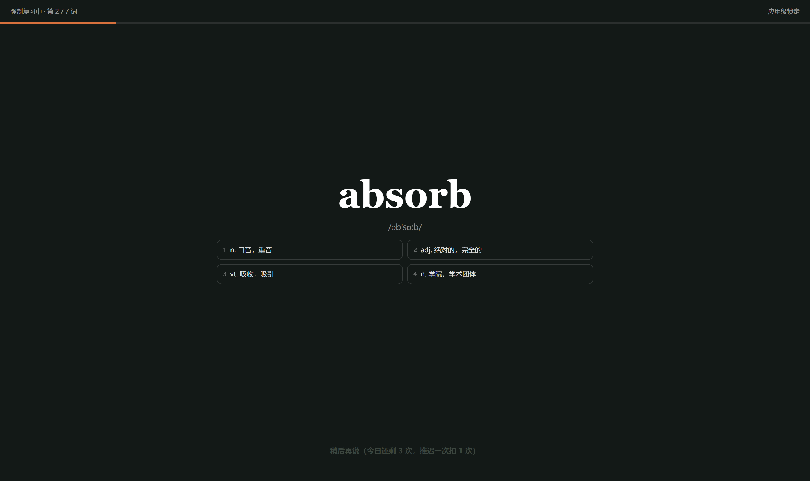

<div align="center">

# 赶词工

**别让单词等你。**

一款「主动找上门」的 Windows 单词复习工具：到点自动弹窗，延后次数有限，复习完自动消失。
词库、排程、记录全部留在本地，断网也能用。

[](https://www.electronjs.org/)
[](https://vuejs.org/)
[](https://www.typescriptlang.org/)
[](#已知边界)
[](LICENSE.txt)

</div>

---

## 这是什么

大多数背单词软件假设你会主动打开它。赶词工反过来：**你把复习时段设好，剩下的交给调度器**。

到点后，它会以温和弹窗或强制全屏的方式把一轮单词推到你面前。你可以「稍后」，但每天只有固定的几次额度；额度用完，就只剩「开始复习」。复习完最后一个词，窗口自动关闭，桌面恢复原样。

- 不是打卡工具，不排名、不社交、没有账号
- 不是云端服务，所有数据都在本机 SQLite 里
- 不靠意志力，靠「到点躲不掉」

## 截图

<p align="center">
  
  <br>
  <sub>强制全屏复习：看英文选释义，作答后短暂停留展示判定，再自动进入下一词</sub>
</p>

<table>
  <tr>
    <td width="50%"></td>
    <td width="50%"></td>
  </tr>
  <tr>
    <td align="center"><sub>答对：正确项高亮，右下角显示当日剩余延后次数</sub></td>
    <td align="center"><sub>答错：正确答案标绿、误选项标红，并展示词形变化</sub></td>
  </tr>
</table>

## 功能总览

| 模块 | 能力 |
| --- | --- |
| 主动触发 | 多个复习时段、触发间隔、单次词数；到点由主进程直接弹窗，无需点击 |
| 复习形态 | 温和弹窗 / 强制全屏；强制全屏再分「应用级」与「Kiosk 级」两档锁定强度 |
| 出题方式 | 看词选义、看中文默写、缺释义时翻牌；可在设置里固定或交给自动规则 |
| 间隔排程 | 简化 SRS：认识按 1→2→4→8→16→30 天递增，不认识打回 1 天 |
| 延后配额 | 默认每天 3 次、每次 10 分钟；跨天自动重置，用完只剩「开始复习」 |
| 本地词库 | 多词表、增删改查、搜索、例句与标签、到期时间与遗忘次数 |
| CSV | 导入兼容 UTF-8 / UTF-8 BOM / GBK，导出统一 UTF-8 BOM，双击 Excel 不乱码 |
| 离线词典 | 内置 18,162 个考试词条，导入时自动补音标、释义与词形变化，零联网 |
| 练习模式 | 自由默写，不写排程、不计入复习进度 |
| 统计 | 近 14 天认识率、最容易忘记的词、词库构成、最近轮次 |
| 桌面行为 | 托盘常驻、开机自启（打包态）、单实例、关闭主窗口只隐藏 |
| 逃生机制 | 全局 `Ctrl + Alt + Esc`，任何锁定状态下都能中断本轮并恢复桌面 |

## 核心循环

```
设置时段 → 到点 → 主进程弹出一轮卡片 → 逐词作答 → 更新间隔排程 → 写日志 → 关窗
                                      ↘ 点「稍后」→ 扣当日额度 → 推迟 N 分钟
```

抽词规则（一轮 N 个，默认 10）：

1. 已学过且 `due_at <= now` 的词，按到期时间升序优先
2. 不足时补新词，按录入顺序
3. 仍不足时补最接近到期的词，允许提前复习
4. 一个词都没有时不弹空窗：定时触发会留一条 `status='empty'` 的轮次记录；手动点「开始复习」只提示没有可复习的词。

## 复习排程

每个单词维护 `interval_days` 与 `due_at`：

| 标记 | 间隔变化 | 说明 |
| --- | --- | --- |
| 认识 | 0 → 1 → 2 → 4 → 8 → 16 → 30 | 指数翻倍，30 天封顶 |
| 不认识 | 直接回到 1 天 | `lapses += 1`，之后会被更频繁抽出 |

## 三种出题方式

| 模式 | 形式 | 何时使用 |
| --- | --- | --- |
| `choice` | 看英文，从 4 个释义里选 1 个 | 复习过的词，默认自动选用 |
| `spell` | 看中文，逐字母默写英文 | 新词，默认自动选用；也适合强记忆 |
| `reveal` | 卡片翻面，自评认识 / 不认识 | 没有释义、无法出选择题时的兜底 |

设置里的「出题方式」可选 `auto`（新词默写、复习过的选义）、`spell`、`choice` 三种，即时生效。

## 两种复习形态与锁定强度

| 形态 | 表现 | 关闭 / 延后 |
| --- | --- | --- |
| 温和弹窗 `gentle` | 420×300 无边框窗口，置顶但不抢焦点，可拖动，默认右上角 | 点关闭或「稍后」消耗 1 次延后额度 |
| 强制全屏 `fullscreen` + `app` | 无边框全屏、最高置顶、失焦夺回、禁止关闭；可配置覆盖所有显示器 | 仅「本轮稍后」（额度未耗尽时）可用；Alt+Tab 离开会被记为中断 |
| 强制全屏 `fullscreen` + `kiosk` | 在应用级之上启动 PowerShell 低级键盘钩子，屏蔽 Win / Alt+Tab / Alt+F4 / Ctrl+Esc | 逃生键由钩子自身识别并放行 |

### 逃生与安全设计

- 全局逃生键 `Ctrl + Alt + Esc`，在任意模式下中断本轮并写入 `escape_used` 事件；已作答的词保留排程更新，未作答的词不动。
- 如果逃生键注册失败（被别的程序占用），强制模式会**自动降级为温和弹窗**，绝不锁住一个没有出口的桌面。
- Kiosk 钩子是独立 PowerShell 子进程：主进程每 1 秒写一次心跳，超过 15 秒没有心跳，子进程自行卸载钩子退出。主进程崩溃也不会把桌面锁死。
- 子进程退出码即原因：`7` 逃生、`8` 心跳超时、`9` 达到 3 小时硬上限、其他为异常。
- `Ctrl + Alt + Del` 属于 Windows 安全序列，任何用户态程序都无法屏蔽——这是刻意保留的最后退路。
- 上次异常退出留下的未完成轮次，启动时静默补记为 `aborted`，不会重复弹窗轰炸。

## 离线词典

- 数据源：[ECDICT](https://github.com/skywind3000/ECDICT) 派生的 `cdict_query@1.0.0`（MIT），构建脚本筛选 `zk / gk / cet4 / cet6 / ky` 考试标签与高频词
- 产物：[`resources/dictionary/words.json`](resources/dictionary/words.json)，实测 **18,162 词条、3.01 MB**，其中 17,334 条带音标、15,203 条带词形变化
- 额外建立「变形 → 原形」倒排索引，`abandoned`、`studies` 这类词也能查到
- 导入或新增单词时若释义为空，自动查表补全；查不到则标记为「待补充释义」
- 打包时词典放在 asar 外，运行时只读本地文件，**无任何出站网络请求**

重新生成词典：

```bash
npm run dict:build
```

脚本会从 npmmirror 下载源包到 `.cache/`（需要 `curl` 和 `tar`），首次约 11 MB。仓库里已经提交了生成好的 `words.json`，一般不需要重建。

## CSV 约定

- 导入编码：UTF-8（含 / 不含 BOM）与 GBK
- 表头自动映射：`word|term|单词|apparent` → 单词；`meaning|释义|翻译|translation|chinese` → 释义；`phonetic|音标`；`example|例句`；`tag|标签|词表`
- 只有单词列也能导入，释义走离线词典
- 导出列：`term,phonetic,meaning,example,tags,interval_days,due_at,reps,lapses`，UTF-8 BOM
- 示例文件：[`samples/四级核心20词.csv`](samples/四级核心20词.csv)

## 键盘操作

| 场景 | 按键 |
| --- | --- |
| 看词选义 | `1`–`4` 选择；判定后 `Space` / `Enter` 立即下一题 |
| 看中文默写 | 字母键输入；`Backspace` 删除；判定后 `Space` / `Enter` 立即下一题 |
| 翻牌 | `Space` 翻面；`1` 不认识；`2` 认识（`Enter` 等同于认识） |
| 结算页 | `Enter` / `Esc` 立即关闭 |
| 练习模式 | 字母键输入；`Backspace` 删除；`Enter` 下一词 |
| 全局逃生 | `Ctrl + Alt + Esc` |

作答后会在判定结果上短暂停留再自动进入下一词，也可以直接按 `Space` / `Enter` 跳过等待。

## 技术栈

| 层 | 选型 |
| --- | --- |
| 桌面框架 | Electron 45 + electron-vite 6 |
| 界面 | Vue 3.5 + TypeScript 5 + Naive UI + Tailwind CSS v4 |
| 状态与路由 | Pinia、Vue Router（hash 模式） |
| 存储 | Electron 自带 `node:sqlite`（`DatabaseSync`），无原生模块 |
| CSV | PapaParse |
| 词典 | 离线 JSON，源自 ECDICT |
| 打包 | electron-builder（NSIS x64） |

选择 `node:sqlite` 而不是 `better-sqlite3`：零原生模块、不需要跟随 Electron 版本重编译，安装失败面和包体都更小。代价是只有同步 API，但千级词条远够不到瓶颈。

## 项目结构

```
赶词工/
├─ src/
│  ├─ main/            # 主进程：调度、轮次、窗口、锁定、数据、托盘
│  ├─ preload/         # contextBridge 类型化 API
│  ├─ renderer/        # Vue 3 界面：复习台 / 词库 / 统计 / 设置 / 练习 / 复习卡片
│  └─ shared/          # 类型、SRS、时间工具、IPC 频道
├─ resources/
│  ├─ dictionary/      # 构建产物 words.json + meta.json
│  ├─ kiosk-lock.ps1   # Kiosk 级低级键盘钩子
│  └─ tray.png
├─ scripts/            # 词典构建脚本 + 开发期 E2E 探针
├─ samples/            # 示例 CSV
├─ docs/               # PRD、UI 规范、截图
├─ build/              # 应用图标
└─ electron-builder.yml
```

### 架构

```
┌─────────────────────────── 主进程 ───────────────────────────┐
│  scheduler ──▶ flow ──▶ windows ──▶ 渲染层复习窗口            │
│      │           │           │                                │
│      │           ├──▶ kiosk ─┴──▶ PowerShell 键盘钩子         │
│      │           └──▶ rounds ──▶ SQLite (node:sqlite)         │
│  shortcuts(逃生键) · tray · autostart · importer · dictionary  │
└────────────────────────────▲─────────────────────────────────┘
                             │ preload / contextBridge（类型化 IPC）
┌────────────────────────────┴─────────────────────────────────┐
│ 渲染层 Vue 3：复习台 · 词库 · 统计 · 设置 · 练习 · 复习卡片   │
└──────────────────────────────────────────────────────────────┘
```

- 渲染层开启 `contextIsolation`、关闭 `nodeIntegration`，只能通过 preload 暴露的白名单方法访问主进程能力。
- 窗口关闭意图统一由主进程裁决：温和模式折算成一次延后，强制模式拒绝关闭。
- 外部链接交给系统浏览器打开，页面内导航被拦截。
- 单实例锁防止多个调度器同时弹窗。

### 数据模型

数据库位于 `%APPDATA%\赶词工\gancigong.db`：

| 表 | 用途 |
| --- | --- |
| `lists` / `words` | 词表与单词，单词按词表唯一 |
| `word_states` | 每个词的间隔、到期时间、复习次数、遗忘次数 |
| `rounds` / `round_items` | 每轮复习与逐词作答记录，状态含 `done / aborted / skipped / empty / open` |
| `delay_slots` | 按本地日期记录当日已用延后次数 |
| `events` | 逃生、Kiosk 锁定、导入、额度耗尽等关键事件 |
| `settings` | 时段、间隔、词数、模式、锁定强度、TTS 等配置 |

## 本地开发

### 环境要求

- Windows 10 / 11（Kiosk 锁定与 NSIS 打包仅支持 Windows）
- Node.js 22+（`node:sqlite` 需要 22.5+，推荐 24 LTS）
- 首次安装依赖：`npm install`

仓库内的 `.npmrc` 使用 npmmirror 镜像加速 Electron 下载，可按需改回官方源。

### 常用命令

```bash
npm install          # 安装依赖
npm run dev          # 开发模式启动（electron-vite）
npm run typecheck    # 主进程 + 渲染层类型检查
npm run dict:build   # 重新生成离线词典（可选）
npm run build        # 编译到 out/
npm run dist         # 类型检查 + 编译 + 打包 NSIS 安装包
```

打包产物输出到 `release/赶词工-0.1.0-setup.exe`（NSIS x64，按用户安装，卸载时保留本地数据）。

### 开发期验收脚本

`scripts/` 下是一组不参与打包的探针，通过 Electron 远程调试端口（`9222`）驱动真实 IPC 管线，覆盖空轮、额度、SRS、导入、Kiosk 自检、缩放等场景，例如：

```bash
npm run dev -- --remote-debugging-port=9222
node scripts/e2e-probe.mjs "samples/四级核心20词.csv"
```

## 数据与隐私

- 所有数据只写入本机 SQLite，没有账号、云同步、埋点或联网查词。
- 运行时不发起任何出站请求；词典、发音（系统 `speechSynthesis`）、统计全部本地完成。
- 卸载时默认保留 `%APPDATA%\赶词工\gancigong.db`，重装后可以接着用；需要彻底清除时手动删除该目录。

## 已知边界

- **仅支持 Windows。** Kiosk 锁定依赖 PowerShell 与 Win32 键盘钩子，NSIS 打包也只配置了 Windows。
- **`Ctrl + Alt + Del` 无法屏蔽。** 它由 winlogon 处理，任何用户态钩子都拦不住，这是设计上的最后退路。
- **Kiosk 键盘钩子可能触发个别杀软提示。** 属于正常现象；应用级锁定不碰系统快捷键，没有这个风险。
- **强制全屏不是防作弊系统。** 应用级锁定仍允许 Alt+Tab 离开，只是会把这轮记为中断；Kiosk 级也只拦截常见组合键。
- **词典覆盖有限。** 内置的是考试高频词表，生僻词或专业词可能查不到，会标记为「待补充释义」。

## 许可

本项目使用 [MIT License](LICENSE.txt)。

第三方资源：

- [ECDICT](https://github.com/skywind3000/ECDICT) / `cdict_query`（MIT）——离线词典数据源
- [Electron](https://github.com/electron/electron)、[Vue](https://github.com/vuejs/core)、[Naive UI](https://github.com/tusen-ai/naive-ui)、[Tailwind CSS](https://github.com/tailwindlabs/tailwindcss)、[PapaParse](https://github.com/mholt/PapaParse)（均为 MIT）

---

<div align="center">
  <sub>赶词工 · 别让单词等你</sub>
</div>
